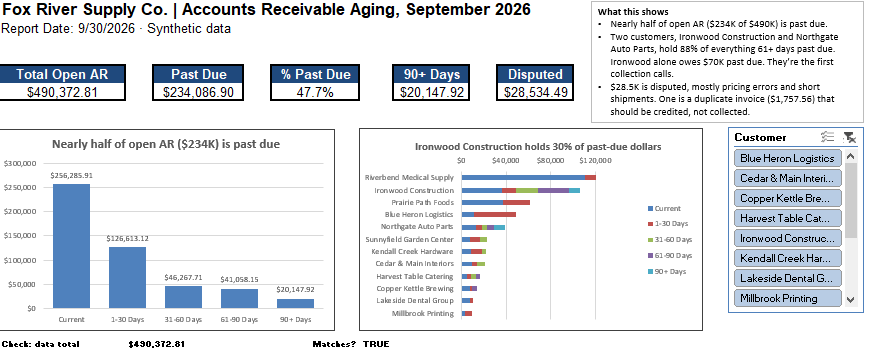
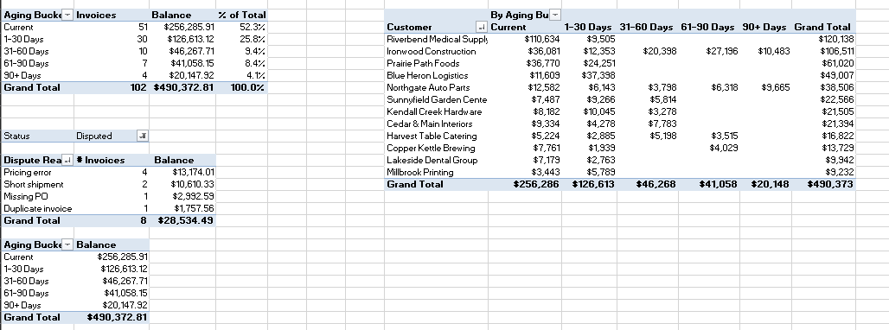
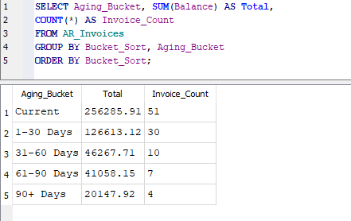
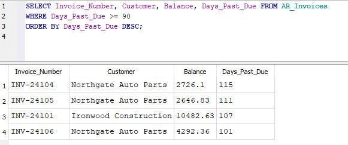

# Accounts Receivable Aging & Collections Analysis

**Excel · Pivot Tables · Slicers · SQL (SQLite) · Tableau Public**

> A self-directed project. Fox River Supply Co. is invented, and so are its customers, invoices and dollars. The questions are the ones an AR team answers at every month-end.



## The problem

It's September month-end at Fox River Supply Co. There are **102 open invoices** across 12 customers, worth **$490K**. Before AR can follow up on anything, it needs to know three things: how much is past due, who owes it, and which invoices aren't really collectible yet because something is wrong with the bill.

In both of my manufacturing jobs, credit holds kept showing up in other reports. At Manufacturer One, $36K of past-due orders was sitting on credit hold and nobody was tracking it. At Manufacturer Two, credit holds were the most common problem in my daily order audit. This project looks at the same money from the AR side.

## The questions

1. **How much of our open AR is past due, and how late is it?**
2. **Which customers should get the first collection calls?**
3. **What billing problems are holding up payment?**

## What I did

| Step | Tool | Action |
|---|---|---|
| 1 | Excel | Turned the invoice export into a table and built an **aging summary pivot** (Current, 1–30, 31–60, 61–90, 90+) |
| 2 | Excel | Built a **customer aging report** (customers × aging buckets), sorted by balance |
| 3 | Excel | Built a **disputes pivot** filtered to disputed invoices, and traced a duplicate invoice back to its original |
| 4 | Excel | Built a **dashboard** with KPI tiles, two charts with action titles, a Customer slicer, and a tie-out check |
| 5 | SQL | Loaded the same data into **SQLite** and wrote queries for the collections call list, the disputes list, and the totals |
| 6 | Tableau | Rebuilt the dashboard in **Tableau Public** with a click-to-filter customer chart |

## What I found

- **Nearly half of open AR is past due: $234,087 of $490,373 (47.7%).**
- **The late money is concentrated.** Ironwood Construction and Northgate Auto Parts hold **88% of everything 61+ days past due**. Ironwood alone owes **$70K past due**, 30% of all past-due dollars. They're the first two calls.
- **The biggest customer isn't the problem.** Riverbend Medical Supply owes the most ($120K), but 92% of it isn't due yet.
- **$28,534 is disputed** on 8 invoices, mostly **pricing errors** ($13.2K) and **short shipments** ($10.6K). Those need a fix from billing or shipping before a collection call will work.
- **One invoice was billed twice.** INV-24202 matches INV-24111: same customer, same date, same $1,757.56. That's a credit memo, not a collection, and until it's issued, AR is overstated.



## Same answer, three tools

Every number on the Excel dashboard was rebuilt in SQL and Tableau from the same data.

| Number | Excel | SQL | Tableau |
|---|---|---|---|
| Total open AR | $490,372.81 | 490372.81 | $490,372.81 |
| Current | $256,285.91 | 256285.91 | $256,285.91 |
| 90+ days | $20,147.92 | 20147.92 | $20,147.92 |
| Invoices 90+ days past due | 4 | 4 | – |
| Disputed | $28,534.49 | 28534.49 | – |
| #1 customer by balance | Riverbend Medical Supply | Riverbend Medical Supply | Riverbend Medical Supply |

### SQL

The aging summary, which is the SQL version of the Excel pivot:



```sql
SELECT Aging_Bucket, SUM(Balance) AS Total,
COUNT(*) AS Invoice_Count
FROM AR_Invoices
GROUP BY Bucket_Sort, Aging_Bucket
ORDER BY Bucket_Sort;
```

The collections call list, oldest first:



```sql
SELECT Invoice_Number, Customer, Balance, Days_Past_Due FROM AR_Invoices
WHERE Days_Past_Due >= 90
ORDER BY Days_Past_Due DESC;
```

More queries (disputes, top customers, the duplicate invoice) are in [`ar_queries.sql`](sql/ar_queries.sql).

### Tableau

**[View the interactive dashboard on Tableau Public](https://public.tableau.com/views/FoxRiverARAging/Dashboard1)**

## Inside the folder

| File | What's there |
|---|---|
| `excel/Fox_River_AR_Aging.xlsx` | Dashboard, Pivots, Invoices (table `ARData`) and About tabs |
| `sql/ar_queries.sql` | 11 queries, each noting which Excel number it matches |
| `data/AR_Invoices.csv` | The shared data (102 invoices) |
| `data/DATA_README.md` | Column definitions and the answer key |

**Report Date: 9/30/2026.** Days Past Due and Aging Bucket are figured as of this date, so the numbers don't change when the file is opened on a different day.

## What I'd do next

- Add a payments file and practice **cash application**: matching payments to invoices
- Track **DSO** (days sales outstanding) month over month
- Reconcile the aging total to a general ledger AR balance for month-end close
