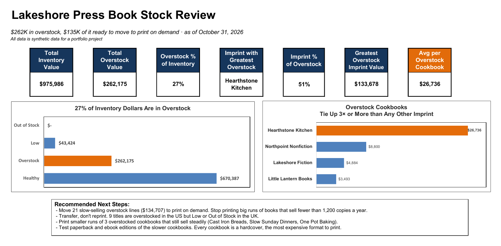

# Book Stock Review: Where Is the Inventory Money Sitting?

**SQL (SQLite) · Joins · Excel · Pivot Tables · Slicers · Conditional Formatting**

> A self-directed project. Lakeshore Press is invented, and so are its imprints, titles, ISBNs and dollars. The questions are the ones an inventory team answers during a regular stock review.



## The problem

Lakeshore Press publishes 80 titles across four imprints: fiction, children's books, nonfiction and cookbooks. Books are stored in two warehouses, one in the US and one in the UK. Some titles are printed in big offset runs and stored; others are **print on demand**, printed only when ordered.

Every book on a shelf is money already spent. Too many copies tie up cash. Too few and the warehouse misses sales. It's October month-end, and the inventory team wants to know where the stock is out of balance.

In manufacturing, I worked on the same problem from the other side: past-due orders held up by parts we didn't have, while other parts sat on the shelf. This project looks at it from a publisher's inventory.

## The questions

1. **How much inventory money is tied up in overstock?**
2. **Which imprints and titles hold the most of it?**
3. **Which titles are about to run out, and can they be covered without printing more?**

## What I did

| Step | Tool | Action |
|---|---|---|
| 1 | SQL | Loaded the stock and title tables into **DB Browser for SQLite** and **joined them on ISBN**. The stock table only knows ISBNs and copy counts; the title, imprint and print program live in the title list. |
| 2 | SQL | Filtered the joined data into three work lists: overstock, print-on-demand candidates, and titles running low |
| 3 | Excel | Turned the joined data into a table and built **pivot tables** by stock status, by imprint, and by title across both warehouses |
| 4 | Excel | Added **slicers** for warehouse and imprint, and **stoplight conditional formatting** to show US and UK stock side by side |
| 5 | Excel | Built a one-page **Findings** page with KPI tiles, two charts with titles that state the finding, and recommended next steps |

## What I found

- **$262K is tied up in overstock**, 27% of the $976K in inventory. These are titles with more than a year of stock on the shelf.
- **Most of it is slow sellers.** 21 of the 25 overstock lines sold fewer than 1,200 copies in the last year. Together they hold **$134,707**.
- **Cookbooks hold half of all overstock dollars.** Hearthstone Kitchen has only **5 overstocked titles, but $133,678 tied up**: an average of **$26,736 per title**. That's about **3 times** the next imprint and 2.5 times the overstock average. Every cookbook is a hardcover at about $9 a copy, the most expensive format in the catalog, so each extra copy ties up more money.
- **The UK is short on titles the US has too many of.** 9 titles are overstocked in the US but low or out of stock in the UK.
- Not every overstocked cookbook is a slow seller. Three of them (*Cast Iron Breads*, *Slow Sunday Dinners* and *One Pot Baking*) still sell steadily. They'll sell through; they just need smaller print runs.

## Recommended next steps

1. **Move the 21 slow-selling overstock lines ($134,707) to print on demand.** Stop printing big runs of books that sell fewer than 1,200 copies a year.
2. **Transfer, don't reprint.** Ship US overstock to the UK for the 9 titles that are low or out there.
3. **Print smaller runs** of the 3 overstocked cookbooks that still sell steadily.
4. **Test paperback and ebook editions of the slower cookbooks.** Every Hearthstone Kitchen title is a hardcover, the most expensive format to print. A paperback ties up about a third as much per copy, and an ebook ties up nothing. As a cookbook author myself (my own cookbook is a paperback), I'd want sales by format before deciding, so this is a test, not a sure win.

## How the workbook is organized

| Sheet | Who it's for | What's there |
|---|---|---|
| **Findings** | Upper management | The bottom line: 7 KPI tiles, two charts and the recommended next steps. One page, no filters. |
| **Dashboard** | Inventory planners, or anyone who wants to dig in | Pivot tables by status and imprint, US vs. UK months of supply with stoplight colors, and slicers |
| **Data** | Anyone who wants the detail | The joined stock and title data as an Excel table (`StockData`) |

**Stoplight colors on the Dashboard:** red = under 2 months of supply (act now), green = 2 to 12 months (fine), yellow = more than 12 months (overstock: decide whether to transfer, discontinue or move to print on demand). The transfer list is every row with a **yellow US** cell next to a **red UK** cell.

## Same answer, two tools

I found the numbers in SQL first, then rebuilt them in Excel.

| Number | SQL | Excel |
|---|---|---|
| Stock lines after the join | 160 | 160 (table rows) |
| Overstock lines | 25 | 25 (pivot count) |
| Overstock dollars | $262,174.72 | $262,175 (pivot) |
| Print-on-demand candidates | 21 lines, $134,707 | – |
| Offset titles low or out of stock | 37 lines (28 in the UK) | – |

### SQL

The join, which puts each stock line together with its title, imprint and print program:

```sql
SELECT * FROM Stock
JOIN Titles
ON Stock.ISBN = Titles.ISBN;
```

The titles running low or out, leaving out print-on-demand titles (they keep little stock on purpose), fastest sellers first:

```sql
SELECT * FROM Stock
JOIN Titles
ON Stock.ISBN = Titles.ISBN
WHERE (Stock.Stock_Status = 'Low' OR Stock.Stock_Status = 'Out of Stock')
AND Titles.Print_Program = 'Offset'
ORDER BY Stock.Units_Sold_12M DESC;
```

All the queries, with comments, are in [`inventory_analysis.sql`](sql/inventory_analysis.sql).

## Inside the folder

| File | What's there |
|---|---|
| `excel/Book_Stock_Review.xlsx` | Findings, Dashboard, Data and About tabs |
| `excel/Book_Stock_Findings.pdf` | The Findings page as a one-page PDF |
| `sql/inventory_analysis.sql` | The join and three filtered work lists, written in DB Browser for SQLite |
| `data/Titles.csv`, `data/Stock.csv` | The two tables (80 titles, 160 stock lines) |
| `data/Stock_Joined.csv` | The joined result |
| `data/DATA_README.md` | Column definitions and the answer key |

**Report Date: 10/31/2026.** Months of supply and stock status are figured as of this date. Months of supply = copies on hand ÷ (copies sold in the last 12 months ÷ 12).

## What I'd do next

- Add **sales by format** to test the paperback and ebook idea before recommending it outright
- Track months of supply **month over month** to see whether the overstock is shrinking
- Rebuild the Findings page in **Tableau**
