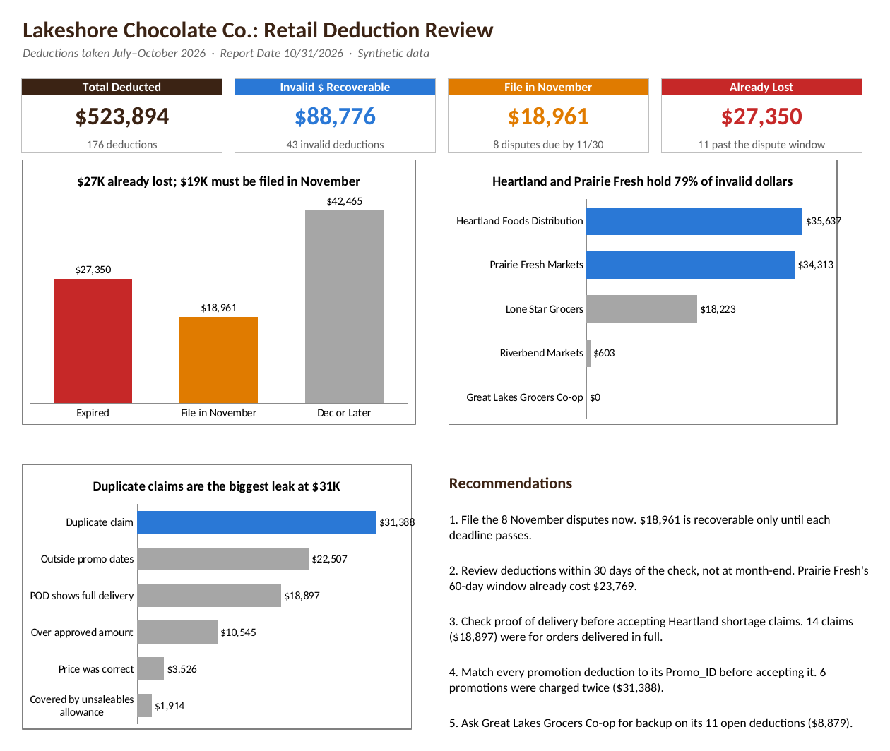

# Retail Deduction Review: Lakeshore Chocolate Co.

**Which retailer deductions can we win back, and which disputes have to be filed first?**

## The problem

When a retailer pays an invoice, it often takes money off the check for promotions, short shipments, damaged product or pricing. Some of these deductions are valid. Some aren't. Each retailer gives the manufacturer a set number of days to dispute a deduction, and once that window closes, the money is gone for good.

This project reviews four months of deductions (July through October 2026) from five grocery and wholesale customers of a confectionery manufacturer. It finds the invalid ones and sorts them by how urgently each dispute has to be filed.

## What I found

- **$88,776 of the $523,894 deducted is invalid and recoverable** (43 of 176 deductions).
- **$18,961 has to be disputed in November** (8 deductions), or it's lost.
- **$27,350 is already lost.** Those 11 invalid deductions passed their dispute window before anyone filed. $23,769 of it is Prairie Fresh Markets, the customer with the shortest window (60 days).
- **Heartland and Prairie Fresh hold 79% of the invalid dollars.** Heartland's comes mostly from shortage claims on orders that proof of delivery shows arrived in full (14 claims, $18,897).
- **Duplicate claims are the biggest single leak:** 6 promotions were charged twice, $31,388.
- **17 deductions ($15,018) are waiting on backup from the retailer**, 11 of them from Great Lakes Grocers Co-op.

## Recommendations

1. **File the 8 November disputes now.** $18,961 is recoverable only until each deadline passes.
2. **Review deductions within 30 days of the check, not at month-end.** Prairie Fresh's 60-day window already cost $23,769.
3. **Check proof of delivery before accepting Heartland shortage claims.** 14 claims ($18,897) were for orders delivered in full.
4. **Match every promotion deduction to its Promo_ID before accepting it.** 6 promotions were charged twice ($31,388).
5. **Ask Great Lakes Grocers Co-op for backup** on its 11 open deductions ($8,879).

## Tools and approach

**SQL (DB Browser for SQLite):** [`sql/deductions_review.sql`](sql/deductions_review.sql)
- Joined the deduction file to the customer list on Retailer_ID, to bring in each retailer's name, channel and account manager.
- Built a recovery list of invalid deductions, sorted by dispute deadline.
- Used **IN** to pull the three key accounts in one filter, and to check promotion and ad/display deductions for duplicates.
- Used **BETWEEN** to find the disputes due in November, and a date filter to find the ones already past the window.
- Exported the joined data to CSV as the source for Excel.

**Excel:** [`excel/Deductions_Review.xlsx`](excel/Deductions_Review.xlsx)
- **Data:** the SQL export as an Excel Table, plus a **Deadline Status** column (Expired / File in November / Dec or Later) built with IFS against the Report Date and November cutoff on the About sheet, using locked references so every row checks the same dates.
- **Pivots:** deductions by review result, retailer, invalid reason and deadline status.
- **Findings:** KPI tiles, three charts with action titles, and the recommendations.

Every number matches between SQL, the pivots and the answer key in the data guide.

## Data

Synthetic. Lakeshore Chocolate Co., its customers, people and dollars are all invented. Report Date: 10/31/2026. Column definitions and an answer key are in [`data/DATA_README.md`](data/DATA_README.md).

## Files

| Folder | What's in it |
|---|---|
| `sql/` | All 9 queries, with comments |
| `excel/` | Workbook: Findings, Pivots, Data, About |
| `data/` | Deductions.csv, Retailers.csv, DATA_README.md |
| `images/` | Findings page screenshot |
