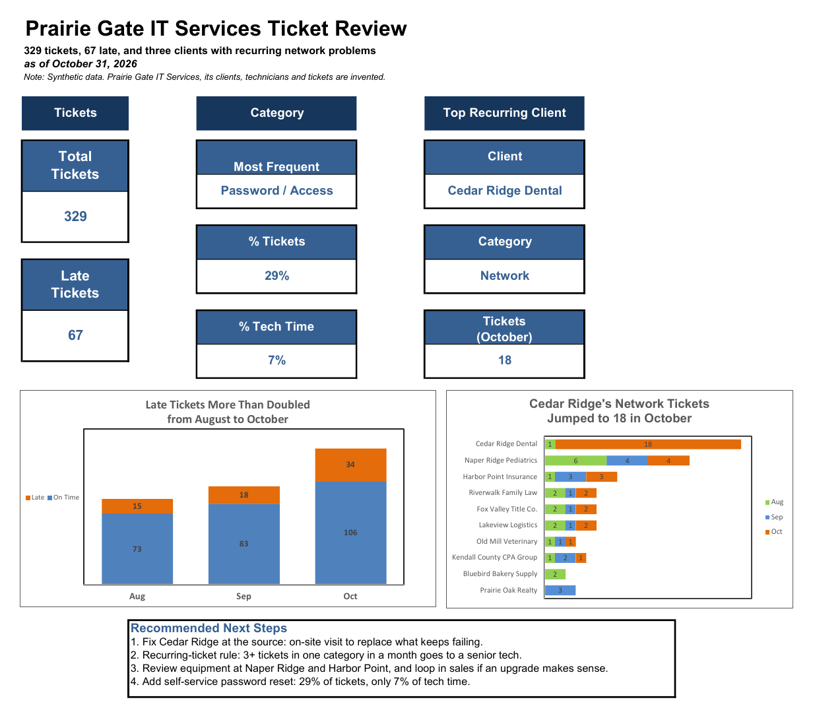

# Service Desk Ticket Review: Why Are Late Tickets Climbing?

**SQL (SQLite) · Joins · Date Filtering · Excel · Pivot Tables · Slicers · IF Formulas · Conditional Formatting · Data Validation**

> A self-directed project. Prairie Gate IT Services is invented, and so are its clients, technicians, tickets and dollars. The questions are the ones a managed services operations team answers at month-end.



## The problem

Prairie Gate IT Services runs IT support for 10 small businesses: dental and medical offices, a title company, a law firm, an insurance agency and others. Each client has a service tier (Gold, Silver or Bronze), and every ticket has a deadline to be resolved by its priority (the SLA).

From August through October 2026, clients opened **329 tickets**. It's October month-end, and the service manager wants to know why the team keeps missing deadlines and what to fix first.

## The questions

1. **Are late tickets getting better or worse?**
2. **What kind of work fills the queue, and what kind takes the time?**
3. **Which clients keep coming back with the same problem?**
4. **What's stuck right now, and why?**

## What I did

| Step | Tool | Action |
|---|---|---|
| 1 | SQL | Loaded the ticket and client tables into **DB Browser for SQLite** and **joined them on Client_ID**. The ticket system only knows a client ID; the name and service tier live in the client list. |
| 2 | SQL | Pulled the **open work queue** (open tickets past their SLA), password tickets, October network tickets by client, vendor delays, and late tickets for Gold clients |
| 3 | Excel | Turned the joined data into a table. Rebuilt **Days Open** with an IF formula so open tickets count up to the Report Date, and flagged **Past SLA** with another IF |
| 4 | Excel | Added a **dropdown** for delay reasons and **conditional formatting** to flag late tickets |
| 5 | Excel | Built **pivot tables** by category, by month, by delay reason, and by client and month, with **slicers** for client and service tier |
| 6 | Excel | Built a one-page **Findings** page with KPI tiles, two charts with titles that state the finding, and recommended next steps |

## What I found

- **Late tickets more than doubled, from 15 in August to 34 in October.** Total tickets rose too (88 to 140), but late tickets grew faster.
- **Password tickets are 29% of all tickets but only 7% of technician time.** Most take 15 to 30 minutes. They fill the queue without being the hard work.
- **One client drove the October spike.** Cedar Ridge Dental opened **18 network tickets in October**, after just 1 in August and September combined. No other client had more than 4. Ten of those 18 went past their SLA. That's not a busy month; something at that office keeps breaking.
- **Two more clients have network problems that keep coming back.** Naper Ridge Pediatrics has had 4 to 6 network tickets every month. That's steady, but steady isn't fine: if I called my support company four times a month for three months, I'd want to know why the fix isn't sticking. Harbor Point Insurance went from 1 to 3 to 3, the early warning before it turns into another Cedar Ridge.
- **Most of today's backlog is waiting on someone else.** Of the 17 open tickets past their SLA, 7 are waiting on the client and 4 are escalated to Tier 2. Across all late tickets, **28 of 67 (42%)** were waiting on a vendor or a part.

## Recommended next steps

1. **Fix Cedar Ridge at the source.** Send someone on-site to find and replace whatever keeps failing, instead of closing the same network ticket over and over.
2. **Start a recurring-ticket rule.** When one client opens 3 or more tickets in the same category in a month, the next one goes to a senior tech for a root cause review. Under this rule, Cedar Ridge, Naper Ridge and Harbor Point would all have been flagged. I set the flag at 3 tickets a month so it's easy to apply. From my own time as both the service requester and the service provider, I'd start asking questions by the second.
3. **Review equipment at Naper Ridge and Harbor Point, and loop in sales.** When a fix doesn't stay fixed, the answer may be newer equipment, not another repair.
4. **Add self-service password reset.** Clients reset their own passwords, and nearly a third of the tickets come off the technicians' queue.

## How the workbook is organized

| Sheet | Who it's for | What's there |
|---|---|---|
| **Findings** | Upper management | The bottom line: KPI tiles in three groups (Tickets, Category, Top Recurring Client), two charts and recommended next steps. One page, no filters. |
| **Dashboard** | Team leads, or anyone who wants to dig in | Four pivot tables, the charts, and slicers for client and service tier. Any client with 3 or more tickets in a month is highlighted. |
| **Data** | Anyone who wants the detail | All 329 tickets joined with their client information, as an Excel table (`TicketData`) |
| **About** | Everyone | What the data is, and the Report Date that every Days Open figure is measured against |

**Built to be refreshed, not rebuilt.** Every KPI tile is a cell reference to a pivot table, not a typed number. The "Most Frequent Category" and "Top Recurring Client" tiles point to the top row of sorted pivots. Next month, add the new tickets, refresh, and the Findings page updates itself, including which client and category are on top.

## Same answer, two tools

I found the numbers in SQL first, then rebuilt them in Excel.

| Number | SQL | Excel |
|---|---|---|
| Tickets after the join | 329 rows | 329 (table rows, pivot grand total) |
| Password / Access tickets | 95 rows | 95 (category pivot) |
| October network tickets | 33 rows | 33 (client pivot, October total) |
| Cedar Ridge network tickets in October | 18 of the 33 | 18 (client pivot) |
| Late tickets waiting on a vendor or part | 28 rows | 28 (delay pivot: 20 + 8) |
| Late tickets for Gold clients | 38 rows | 38 (Gold on the tier slicer) |
| Open tickets past SLA | 17 rows | – |

### SQL

The open work queue: tickets still open and past their SLA, oldest first, with client names from the join.

```sql
SELECT * FROM Tickets
JOIN Clients
ON Tickets.Client_ID = Clients.Client_ID
WHERE Status = 'Open'
AND Past_SLA = 'Yes'
ORDER BY Date_Opened ASC;
```

October network tickets, grouped by client. This is where Cedar Ridge stood out.

```sql
SELECT * FROM Tickets
JOIN Clients
ON Tickets.Client_ID = Clients.Client_ID
WHERE Category = 'Network'
AND Date_Opened >= '2026-10-01'
ORDER BY Client_Name ASC;
```

All 8 queries, with comments and row counts, are in [`ticket_analysis.sql`](sql/ticket_analysis.sql).

## Inside the folder

| File | What's there |
|---|---|
| `excel/Ticket_Review.xlsx` | Findings, Dashboard, Data and About tabs |
| `excel/Ticket_Review_Findings.pdf` | The Findings page as a one-page PDF |
| `sql/ticket_analysis.sql` | 8 queries, written in DB Browser for SQLite |
| `data/Tickets.csv`, `data/Clients.csv` | The two tables (329 tickets, 10 clients) |
| `data/Tickets_Joined.csv` | The joined result |
| `data/DATA_README.md` | Column definitions and the answer key |

**Report Date: 10/31/2026.** Days Open and Past SLA are figured as of this date. For open tickets, Days Open counts up to the Report Date.

## What I'd do next

- Track the recurring-ticket flags **month over month** to see whether Cedar Ridge, Naper Ridge and Harbor Point drop off after the fixes
- Measure how many password tickets disappear once self-service reset is in place
- Add **ticket-by-ticket time stamps** to separate the time a ticket waits on a vendor or the client from the time the team is actually working it
