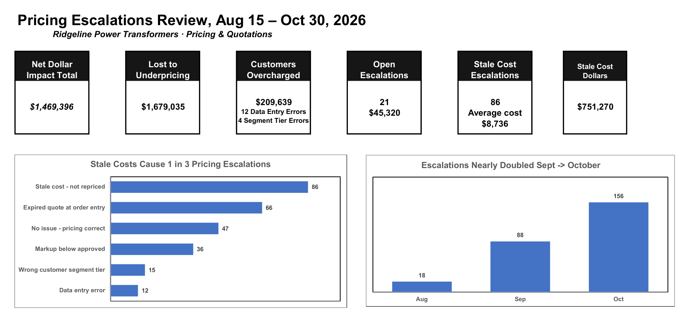

# Pricing Escalations Review

**Excel · Pivot Tables · SUMIF / COUNTIF · Slicers · SQL (SQLite)**

> A self-directed project. Ridgeline Power Transformers is invented, and so are its customers, quotes and dollars. The questions are the ones a pricing and quotation team answers when Inside Sales keeps flagging prices that look wrong.



## The problem

Ridgeline Power Transformers sells pole-mount, pad-mount and substation transformers to utilities, OEMs and industrial customers. When Inside Sales thinks a quoted price is wrong, they log a **pricing escalation**. The log had **262 escalations** from August 15 to October 30, 2026.

The Pricing & Quotation manager wants to know four things:

1. **What's causing most of the escalations?**
2. **What are the pricing errors costing us, in both directions?**
3. **What's still open, and what should the team work first?**
4. **Is it getting better or worse?**

## What I did

| Step | Tool | Action |
|---|---|---|
| 1 | SQL | Explored the database in **DB Browser for SQLite** and filtered the escalations log by root cause, status and dollar impact |
| 2 | SQL | Counted escalations for each root cause and **tied the counts back to all 262 rows** |
| 3 | SQL | Pulled the top 10 escalations by dollars, and built an **open work queue** for the two biggest problem areas |
| 4 | Excel | Turned the log into a table, fixed date and currency formats, and used **SUMIF** to split dollar impact into losses and overcharges |
| 5 | Excel | Built **pivot tables** by root cause and by month, with charts and slicers |
| 6 | Excel | Built a one-page **Findings** page for management, with KPI tiles and two charts with titles that state the finding |

## What I found

- **Stale costs cause 1 in 3 escalations.** 86 of 262 escalations came from quotes that weren't repriced after costs went up. Stale costs also account for **6 of the 10 biggest escalations**, and **$751,270** in dollar impact, an average of **$8,736 each**.
- **Errors go both ways.** Underpricing cost **$1,679,035**. But **16 escalations were customers being overcharged ($209,639)**: all 12 data entry errors plus 4 wrong customer segment tiers. Those become customer credits, not lost margin.
- **Escalations nearly doubled from September to October** (88 to 156). The problem is growing, not settling down.
- **47 escalations (18%) had no pricing problem at all.** That's time Inside Sales and Pricing spent checking prices that were already right.
- **21 escalations are still open.** The work queue starts with the open stale-cost and expired-quote escalations: 14 of them, sorted by dollars.

## How the workbook is organized

I split the workbook by **who is reading it**:

| Sheet | Who it's for | What's there |
|---|---|---|
| **Findings** | Upper management | The bottom line: KPI tiles and two charts. No filters, no detail, just "here are our numbers." |
| **Dashboard** | Mid-level managers, or anyone who wants to dig in | Pivot tables, charts and slicers (root cause, logged by) to slice the numbers their own way |
| **Data** | Anyone who wants the detail | The full escalations log as an Excel table, plus the SUMIF / COUNTIF cells that feed the tiles |

The Findings page stays clean, and the detail is one tab away for anyone who needs it.

## Same answer, two tools

I found the numbers in SQL first, then rebuilt them in Excel.

| Number | SQL | Excel |
|---|---|---|
| Total escalations | 262 (six root-cause counts add back to 262) | 262 (pivot grand total) |
| Stale cost escalations | 86 | 86 (COUNTIF and pivot) |
| Open escalations | 21 | 21 |
| Customers overcharged | Negative dollar impacts at the top of an ascending sort | $209,639 (SUMIF, less than zero) |
| Lost to underpricing | – | $1,679,035 (SUMIF, greater than zero) |
| Net dollar impact | – | $1,469,396 (ties to the table's total row: losses minus overcharges) |

### SQL

The open work queue: open escalations from the two biggest problem areas, largest dollars first (14 rows).

```sql
SELECT * FROM pricing_escalations
WHERE status = 'Open'
AND (root_cause = 'Stale cost - not repriced'
OR root_cause = 'Expired quote at order entry')
ORDER BY dollar_impact DESC;
```

All 8 queries, with row counts and results, are in [`escalations_analysis.sql`](sql/escalations_analysis.sql).

## Inside the folder

| File | What's there |
|---|---|
| `excel/Pricing_Escalations_Dashboard.xlsx` | Findings, Dashboard and Data tabs (table `Escalations`) |
| `excel/Pricing_Escalations_Findings.pdf` | The Findings page as a one-page PDF |
| `sql/escalations_analysis.sql` | 8 queries, written in DB Browser for SQLite |
| `data/pricing_escalations.csv` | The escalations log (262 rows) |

## What I'd do next

- **Fix stale costs at the source:** a check that flags any open quote still using last month's cost after a cost update
- **Cut down the "no issue" escalations** by giving Inside Sales a quick way to see the approved price before escalating
- Track the escalation count **week by week** to see whether fixes are working
